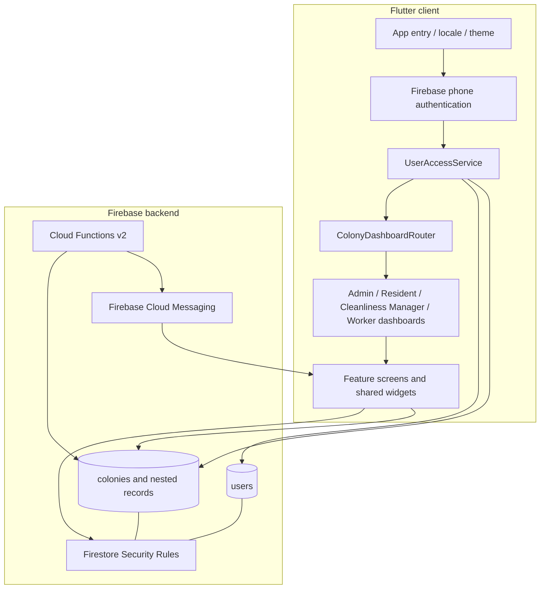

# MohallaFlow Architecture

## Runtime composition

## Client structure observed in the audited source

- `lib/main.dart`: Flutter binding, locale initialisation, Firebase initialisation and application launch.
- `lib/app.dart`: Material application, theme, English/Hindi supported locales, locale scope and splash route.
- `lib/models/user_role.dart`: four role enum values, access statuses, colony membership and access result objects.
- `lib/services/user_access_service.dart`: loads the root user profile and reads exact colony membership documents; validates account/membership status and role.
- `lib/services/colony_dashboard_router.dart`: maps membership role to the appropriate dashboard.
- `lib/services/notification_service.dart` and `push_notification_service.dart`: client notification and push installation behavior.
- `lib/screens/`: feature screens. Many screens currently perform Firestore work directly; a complete repository/service abstraction has not yet been established.
- `functions/index.js`: privileged backend triggers, callable and scheduled functions.

## Authentication and role resolution

1. The client authenticates using Firebase Authentication phone sign-in.
2. `UserAccessService` reads `users/{uid}` and requires an active account.
3. The profile's `colonyIds` are used to read `colonies/{colonyId}/members/{uid}`.
4. A membership must identify the same UID and colony, be active, and contain a recognised role.
5. `ColonyDashboardRouter` selects Admin, Resident, Cleanliness Manager or Worker UI. Resident/Worker routing also requires the corresponding linked record ID.

This client-side routing is for navigation and usability only. Firestore Security Rules and trusted backend code must independently enforce authorization; hiding a button is not a security control.

## Data isolation

Colony-owned operational data is generally stored beneath `colonies/{colonyId}/...`. Root `users/{uid}` profiles and colony membership records connect an authenticated account to one or more colonies. Query constraints must be compatible with Rules; client queries must not fetch broad cross-colony collections and filter locally.

The detailed collection inventory is in [`FIRESTORE_DATA_MODEL.md`](FIRESTORE_DATA_MODEL.md).

## Backend functions observed

`functions/index.js` exports Cloud Functions v2 triggers/callables/scheduled work for:

- Push notification dispatch when colony notification documents are created.
- Emergency SOS notification on create/update and scheduled escalation of unacknowledged alerts.
- Callable resident-registration claiming (`claimResidentRegistration`).

The Functions runtime is declared as Node.js 22. Admin SDK operations bypass client Rules; every callable/trigger must validate the caller/event and constrain target documents server-side.

## Data flow examples

### Complaint and cleanliness task

Resident UI writes a colony-scoped complaint -> authorized Admin reviews and routes it -> Cleanliness Manager assigns a worker/task where appropriate -> Worker accesses assigned work and records completion -> authorized dashboards read the resulting state. This is the product workflow model; complete automated E2E verification remains in progress.

### Announcements and notifications

An authorized screen creates a colony-scoped announcement/notification record -> Cloud Functions notification trigger identifies eligible active memberships and push installations -> FCM sends a push -> delivery receipts record per-device outcome. Push delivery depends on platform notification configuration, device registration and Apple/Google platform entitlements.

## External integrations

- Firebase Authentication (phone sign-in).
- Cloud Firestore.
- Firebase Cloud Functions v2 / Admin SDK.
- Firebase Cloud Messaging.
- Flutter plugins for preferences, file selection/opening, path handling and URL launch.

The audited dependency manifest does not include the Firebase Storage plugin. Do not document Cloud Storage as an active integration without a separately verified implementation.

## Current architecture risks

- Direct Firestore access in feature screens makes isolated unit testing harder; extract service/repository boundaries incrementally.
- Root Firestore Rules are over the documented source limit in the audited snapshot; do not deploy until corrected and accepted.
- A passing selected Rules Emulator suite does not prove all collection paths, queries and workflows are secure.
- Full multi-role integration tests and platform push-delivery tests remain outstanding.
